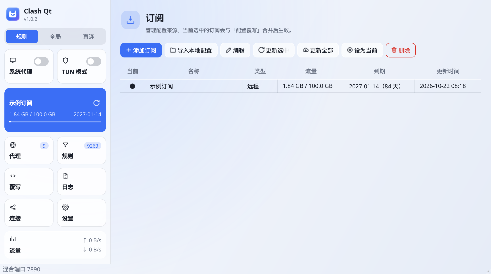

# Clash Qt

[](https://github.com/lhdjply/clash-qt/actions/workflows/build.yaml)
[](https://github.com/lhdjply/clash-qt/actions/workflows/test.yaml)

[English](README.md) · **简体中文**

一个 Clash 订阅客户端，用 Qt6 / C++ 写成，**代理内核直接编在同一个进程里**。
不需要另外下载、更新或守护一个内核二进制 —— 内核的目标文件直接链进可执行文件、进程内
直调，界面是叠在它上面的一个 Qt6 Widgets 窗口。

它按规则分流（域名 / IP-CIDR / GEOSITE / RULE-SET 以及逻辑规则），支持 VLESS
（含 REALITY 与 XTLS Vision）与 Hysteria2，提供 HTTP / SOCKS5 / MIXED 入站，
用 fake-IP 池应答 DNS，跟踪连接，并能通过 TUN 接管全部本机流量，代理那些不认系统代理
的程序。



## 功能

**内核**

- 规则引擎：DOMAIN(-SUFFIX / -KEYWORD / -REGEX)、IP-CIDR(-6)、GEOIP、GEOSITE、
  PORT / NETWORK / PROCESS / UID、RULE-SET、AND / OR / NOT，支持 `no-resolve` 与单条启停
- DNS：hosts（含通配）、nameserver-policy、UDP / TCP / DoH、带 TTL 的缓存、
  fake-IP 地址池与反查
- 出站：DIRECT / REJECT / HTTP / SOCKS5、VLESS（裸 TCP、TLS、WebSocket、
  REALITY + XTLS Vision）、Hysteria2（QUIC + HTTP/3 鉴权）；Selector / URLTest /
  Fallback 代理组
- 入站：HTTP、SOCKS5、MIXED（同端口双协议）；TUN 数据面支持 UDP 中继
- 未实现的协议会明确报错，不会静默退回直连

**界面**

- 瓦片式侧栏：出站模式、系统代理与 TUN 开关、当前订阅及用量、六格导航、上下行实时速率
- 代理页（带延迟测试）、订阅管理、连接页（可按规则关闭）、规则页（搜索与启停）、
  规则覆写、日志、流量曲线、设置
- 订阅：远程下载与更新（从 `subscription-userinfo` 读取流量与到期）、本地导入、切换，
  配置分三层（`config.yaml` / `profile.yaml` / `override.yaml`），应用设置、订阅元数据
  与规则覆写各自独立
- 系统集成：系统代理（gsettings 与 KDE kio）、TUN 模式、开机自启动、系统托盘
- 中英文界面（源文案是英文）、默认跟随桌面的浅色 / 深色主题、检查 GitHub Releases 更新

## 快速开始

依赖 Qt 6.2+（Core / Network / Widgets / Sql / Svg / Charts）、CMake 3.21+ 与支持
C++20 的编译器。

```bash
git clone --recursive <repo>
cmake -S . -B build -G Ninja -DCMAKE_BUILD_TYPE=Release
cmake --build build -j$(nproc)
./build/bin/clash-qt
```

Windows 用 MinGW 并显式指定 Qt 前缀；具体命令、离线构建、改软件名与改版本号都在下面
的文档里。

## 文档

README 只保留最短路径，其余内容都在 `docs/zh/`：

| 文档 | 内容 |
|---|---|
| [build.md](docs/zh/build.md) | 依赖、Linux 与 Windows 构建、离线构建、改名与版本号 |
| [architecture.md](docs/zh/architecture.md) | 目录结构、内核与应用的实现范围、尚未实现的部分 |
| [protocols.md](docs/zh/protocols.md) | Hysteria2 实现细节与边界、真实订阅的兼容性验证 |
| [limitations.md](docs/zh/limitations.md) | 已知差异与刻意的取舍 |
| [development.md](docs/zh/development.md) | 测试、界面翻译、界面出图、持续集成 |
| [packaging.md](docs/zh/packaging.md) | Debian 打包、包内布局、setuid 的取舍 |

文档同时提供[英文版](docs/en/)。

## 许可证

Apache License 2.0，见 [LICENSE](LICENSE)。
