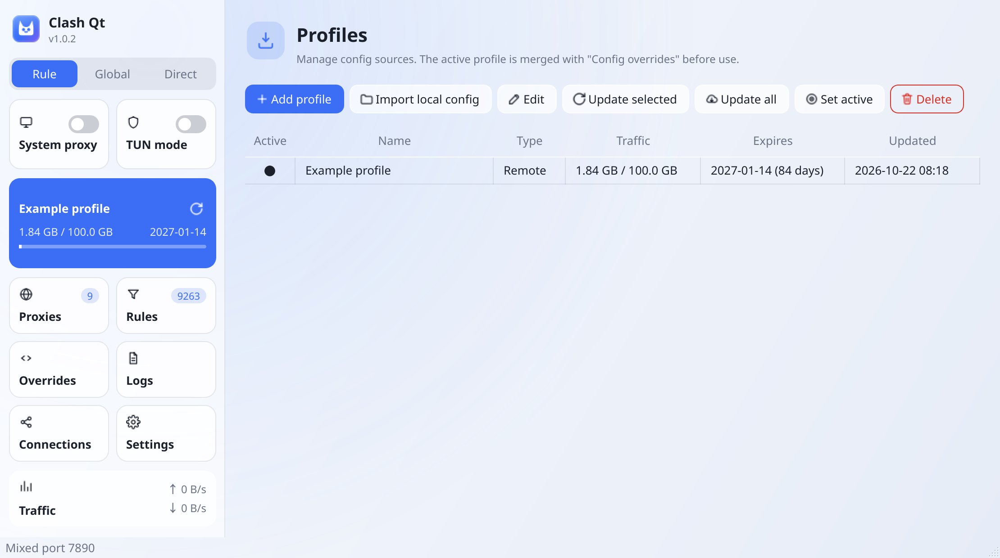

# Clash Qt

[](https://github.com/lhdjply/clash-qt/actions/workflows/build.yaml)
[](https://github.com/lhdjply/clash-qt/actions/workflows/test.yaml)

**English** · [简体中文](README-zh.md)

A desktop client for Clash-style subscriptions, written in Qt6 / C++, with the
**proxy kernel compiled into the same process**. There is no external core binary to
download, update, or keep in sync — the kernel's object files are linked straight into the
executable and called in-process, and the GUI is a single Qt6 Widgets window on top of it.

It routes by rule (domain / IP-CIDR / GEOSITE / RULE-SET and logical rules), speaks VLESS
(including REALITY and XTLS Vision) and Hysteria2, serves HTTP / SOCKS5 / MIXED inbounds,
answers DNS with a fake-IP pool, tracks connections, and can take over all local traffic
through TUN for apps that ignore the system proxy.



## Features

**Proxy core**

- Rule engine: DOMAIN(-SUFFIX / -KEYWORD / -REGEX), IP-CIDR(-6), GEOIP, GEOSITE, PORT /
  NETWORK / PROCESS / UID, RULE-SET, AND / OR / NOT, with `no-resolve` and per-rule toggles
- DNS: hosts (including wildcards), nameserver-policy, UDP / TCP / DoH, cache with TTL,
  fake-IP pool and reverse lookup
- Outbounds: DIRECT / REJECT / HTTP / SOCKS5, VLESS (plain, TLS, WebSocket, REALITY +
  XTLS Vision), Hysteria2 (QUIC + HTTP/3 auth); Selector / URLTest / Fallback groups
- Inbounds: HTTP, SOCKS5, MIXED (both protocols on one port); UDP relay over TUN
- Unimplemented protocols fail loudly instead of falling back to a direct connection

**Application**

- Sidebar of tiles: outbound mode, system-proxy and TUN switches, the active profile with
  its traffic and expiry, a six-tile navigation grid, live upload / download speed
- Pages for proxies with latency tests, profile management, connections (with per-rule
  close), rules with search and enable / disable, rule overrides, logs, traffic charts and
  settings
- Subscriptions: remote download and update with traffic / expiry from
  `subscription-userinfo`, local import, switching, plus a three-layer config
  (`config.yaml` / `profile.yaml` / `override.yaml`) that keeps app settings, subscription
  metadata and rule overrides apart
- System integration: system proxy (gsettings and KDE kio), TUN mode, autostart, tray
- Chinese and English UI (source strings are English), light and dark themes that follow
  the desktop by default, update check against GitHub Releases

## Quick start

Requires Qt 6.2+ (Core / Network / Widgets / Sql / Svg / Charts), CMake 3.21+ and a C++20
compiler.

```bash
git clone --recursive <repo>
cmake -S . -B build -G Ninja -DCMAKE_BUILD_TYPE=Release
cmake --build build -j$(nproc)
./build/bin/clash-qt
```

Windows builds with MinGW and an explicit Qt prefix; the details, the offline build notes
and how to rename the app or bump the version live in the documentation below.

## Documentation

The README is deliberately short — everything else lives in `docs/en/`:

| Document | Contents |
|---|---|
| [build.md](docs/en/build.md) | Dependencies, Linux and Windows builds, offline builds, renaming and versioning |
| [architecture.md](docs/en/architecture.md) | Repository layout, what the kernel and the app implement, what is still missing |
| [protocols.md](docs/en/protocols.md) | Hysteria2 internals and boundaries, compatibility verified against a real subscription |
| [limitations.md](docs/en/limitations.md) | Known differences and deliberate trade-offs |
| [development.md](docs/en/development.md) | Tests, UI translations, UI snapshots, continuous integration |
| [packaging.md](docs/en/packaging.md) | Debian packaging, package layout, the setuid trade-off |

The documentation is also available in [Chinese](docs/zh/).

## License

Apache License 2.0 — see [LICENSE](LICENSE).
